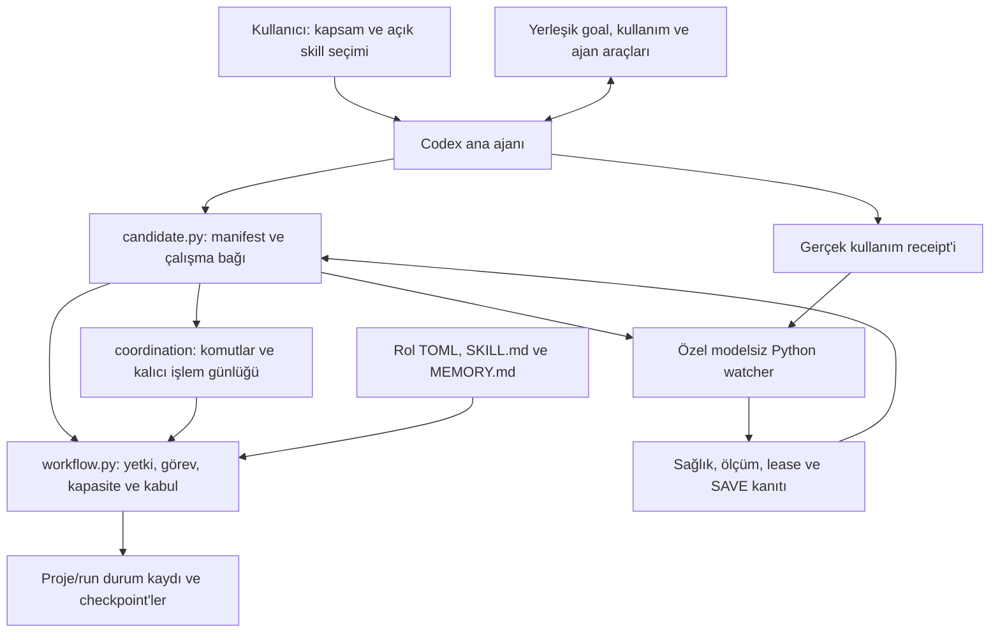
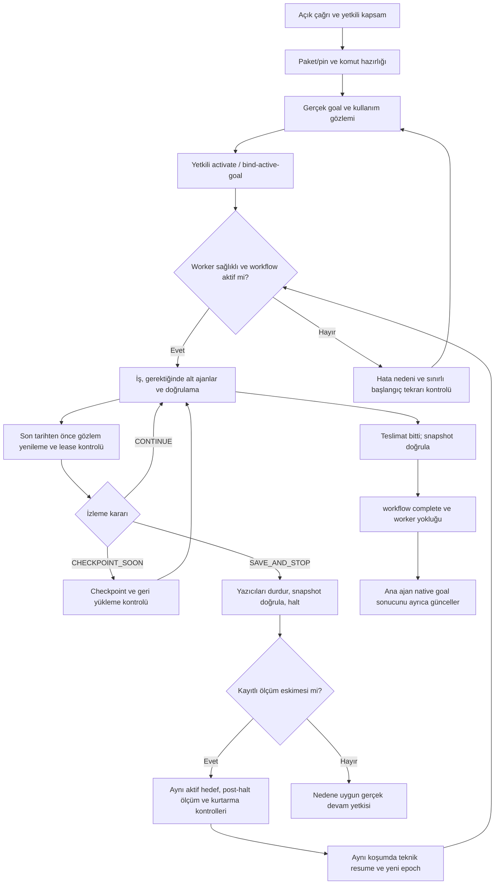
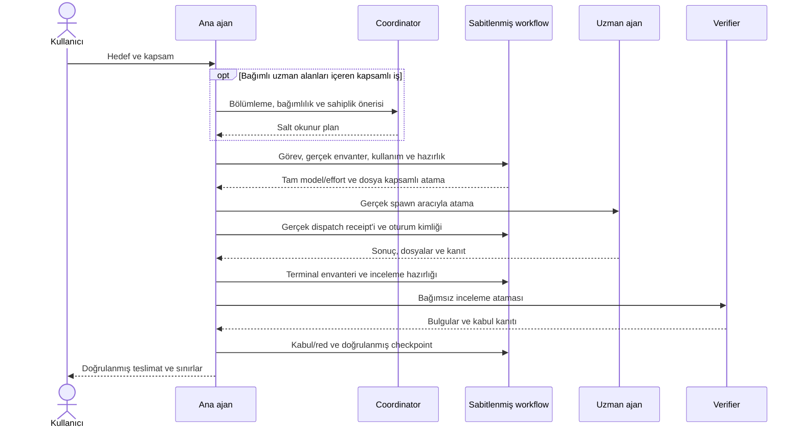

# AGWF v1.1 — Agent Workflow for Codex

**Codex görevlerini hedefe bağlı, izlenebilir ve güvenle devam edilebilir bir iş akışıyla yürütmek için skill ve Python çalışma araçları.**

AGWF; ana ajanın görevleri bölmesine, gerektiğinde uzman alt ajanlar kullanmasına, dosya sahipliğini izlemesine, sonuçları bağımsız inceletmesine ve kullanım sınırına yaklaşırken doğrulanmış bir kurtarma kaydı hazırlamasına yardımcı olur. Kod geliştirme, araştırma, belge hazırlama ve analiz işlerinde kullanılabilir. Küçük işler ana ajanda kalabilir; her iş için bir takım kurulması gerekmez.

Paket sürümü **1.1**, görünen ad **agent-workflow-v1.1**, teknik skill kimliği ve kurulum klasörü **`agent-workflow-v1-1`**'dir. Skill'i **`$agent-workflow-v1-1`** ile çağırın. Yeni çalışma kayıtları **`.agent-workflow-v1-1/runs/<run-id>`** altında oluşur. Kaynak commit'i, manifest ve harici SHA-256 kaydı kullanılan paketi doğrular. [Sürüm değişiklikleri](CHANGELOG.md).

## Ne sağlar?

- **Açık başlangıç:** Skill çağrıldığında ana ajan yetkili kapsam için izlemeyi başlatır ve gerçek worker sağlığını doğrular. Skill'i okumak başlangıç sayılmaz.
- **Hedef bağı:** Proje, run kimliği, sürüm ve kaynak hash'leri sabitlenir; farklı hedef veya paket sessizce aynı kayda bağlanamaz.
- **Kontrollü görev paylaşımı:** Dosyaların tek yazarı, bağımlılıklar, kapasite ve inceleme gereksinimleri kaydedilir. Hazırlanan atamaları gerçek Codex araçlarıyla ana ajan gönderir.
- **Kullanım izlemesi:** Modelsiz Python worker, ana ajanın sağladığı gerçek kullanım gözlemlerini denetler; eskimiş veriyi sağlıklı göstermez.
- **Doğrulanmış checkpoint:** Değişen dosyalar, silinmiş dosya kayıtları ve workflow durumu saklanır. Ayrı dizinde geri yükleme ve hash kontrolü yapılır.
- **Sınırlı toparlanma:** Ölçüm eskimesi nedeniyle teknik kesinti, aynı yetkili aktif hedefte taze gözlem ve kurtarma kontrolleriyle giderilebilir. Gerçek kota ve kullanıcı duruşları farklı kurallara tabidir.

## Mimari

Ana ajan karar ve teslimat sorumluluğunu taşır. `candidate.py` sabitlenmiş giriş noktasıdır; `workflow.py` durum ve kuralları uygular. Özel watcher ayrı Python sürecinde model çağırmadan çalışır. Rol belgeleri ve private bağımlılıklar tek manifest kapsamındadır.



Worker yerleşik kullanım aracını çağıramaz. Ana ajan yeni gözlem iletmezse veri eskir ve izleme duruş ister. Kalp atışı yeni kullanım ölçümü veya yeni kullanıcı yetkisi değildir.

## Workflow



İlk etkinleştirme ölçüm eskimesiyle reddedilirse candidate denemeyi kaydeder. Aynı kapsamda tekrar için hata yanıtındaki `startup_retry.attempt_sha256` haricen korunur ve `--startup-attempt-sha256` ile verilir. Yarım, değiştirilmiş veya başka duruş nedenine ait kayıt tekrar yetkisi değildir. [İşletim ve toparlanma sözleşmesi](skills/agent-workflow-v1-1/references/operations.md).

## Orchestration



| Rol | Sorumluluk | Paket varsayılanı |
|---|---|---|
| Ana ajan | Yetki, gerçek araç çağrıları, entegrasyon ve teslimat | Kullanıcının Codex'te seçtiği model/effort |
| Coordinator | Bağımlı uzman işlerini bölme ve sahiplik önerisi | `gpt-6.1-sol` / `high` |
| Architect | Maliyetli mimari kararlar ve teknik anlaşmazlıklar | `gpt-6.1-sol` / `high` |
| Implementer | Tasarım, geliştirme ve düzeltme | `gpt-6.1-sol` / `high` |
| Researcher | Kaynak toplama, karşılaştırma ve sentez | `gpt-6.1-sol` / `high` |
| Verifier | Sonuç ve artefaktları bağımsız sınama | `gpt-6.1-sol` / `high` |
| Limit watcher danışmanı | Yalnız belirsiz toparlanma kararlarında danışma | `gpt-6.1-terra` / `medium` |

Rutin izleme son satırdaki modele değil Python worker'a aittir. Alt ajan rollerinde yalnız `gpt-6.1-sol`, `gpt-6-astra`, `gpt-6.1-terra` ve en az `medium` effort kullanılabilir. Rolün seçtiği model yoksa otomatik başka modele geçilmez. Her rolün kendi `SKILL.md` ve `MEMORY.md` belgesi vardır. Hazırlanan model ayarı, sağlayıcıdan gözlenmiş etkin model kanıtı değildir.

## Manuel kurulum

Python **3.11+** ve standart kütüphane yeterlidir. Git kaynağı almak için gerekir. Yönetici yetkisi zorunlu değildir; kullanıcı skill klasörüne erişim gerekir. PowerShell örneği:

```powershell
git clone https://github.com/Zehelit/agent-workflow-v1.1.git
Set-Location agent-workflow-v1.1
python --version
git rev-parse HEAD

# Yeni bir çıktı dizini kullanın; mevcut build üzerine yazılmaz.
$build = Join-Path $env:TEMP ('agwf-build-' + [guid]::NewGuid().ToString('N'))
python -X utf8 -B tooling/build-candidate.py --output $build
if ($LASTEXITCODE -ne 0) { throw 'Build başarısız' }
$receipt = Get-Content -LiteralPath (Join-Path $build 'build-receipt.json') -Raw | ConvertFrom-Json
$pin = $receipt.manifest_sha256
$package = Join-Path $build 'agent-workflow-v1-1'
$entry = Join-Path $package 'scripts/candidate.py'
$manifest = Join-Path $package 'manifest.json'

# Receipt'i paket dışında koruyun; beklenmedik değişiklikte yeni pin üretmeyin.
$receipt | ConvertTo-Json | Set-Content -LiteralPath (Join-Path $build 'accepted-build-receipt.json') -Encoding utf8
$codexRoot = if ($env:CODEX_HOME) { $env:CODEX_HOME } else { Join-Path $env:USERPROFILE '.codex' }
$destination = Join-Path $codexRoot 'skills/agent-workflow-v1-1'
python -X utf8 -B $entry --manifest $manifest --manifest-sha256 $pin --version 1.1 install --destination $destination
if ($LASTEXITCODE -ne 0) { throw 'Kurulum doğrulanmadı' }
```

`activated:false`, dosyaların kurulduğunu belirtir; goal veya worker başlamış olmaz. Kullanıcı klasörüne kurulum tek projeye bağlı değildir. Codex skill seçicisinde **agent-workflow-v1.1** görünen adı veya **`$agent-workflow-v1-1`** teknik adıyla seçin; mevcut sohbetin skill kataloğunun yenilenmesi gerekebilir. Kurulum istemciyi yeniden başlatmaz ve model ayarlarını değiştirmez.

Kurulan girişi ayrı bir kontrol projesinde doğrulayın:

```powershell
$probe = Join-Path $env:TEMP ('agwf-probe-' + [guid]::NewGuid().ToString('N'))
New-Item -ItemType Directory -Path $probe | Out-Null
$installedEntry = Join-Path $destination 'scripts/candidate.py'
$installedManifest = Join-Path $destination 'manifest.json'
python -X utf8 -B $installedEntry --manifest $installedManifest --manifest-sha256 $pin --version 1.1 --project $probe --run-id install-check workflow validate
```

Bu pasif kontrol canlı goal, Remote veya alt ajan kabul testi değildir. Linux/macOS'ta aynı Python komutları ve `~/.codex/skills/agent-workflow-v1-1` hedefi kullanılabilir; Windows ACL davranışı platforma özeldir.

### Güncelleme

Önce size ait eski worker'ları **eski giriş noktası ve pin ile** durdurup gerçek çıkışı doğrulayın. Başka sohbetin aktif kurulumunu kesmeyin. Kurulum dosyaları değiştirilmişse farkları koruyup inceleyin; üzerine körlemesine yazılmaz. Install komutuna `--update` eklemek yalnız sahipliği doğrulanan, değiştirilmemiş kurulumu günceller. Eski çalışma kaydının paket bağını değiştirmeyin; onaylı güncellemeden sonra yeni paketle yeni run kimliği kullanın. [Paket bağı, ACL ve işlem geri alma ayrıntıları](skills/agent-workflow-v1-1/references/coexistence.md).

Önceki teknik kimlikteki kullanıcı kurulumundan geçiş, yeni `agent-workflow-v1-1` klasörüne **temiz kurulum** gerektirir. Eski klasöre `--update` uygulamayın. Yeni paketi doğruladıktan sonra Codex skill yol kayıtlarını mevcut enabled/disabled tercihleriyle taşıyın ve eski paketi keşif kökünün dışında arşivleyin. Eski runtime kayıtlarını yeniden adlandırmayın veya pin'lerini değiştirmeyin. [Teknik kimlik geçişi](skills/agent-workflow-v1-1/references/migration.md).

## Ajan için kurulum rehberi

1. Kullanıcı skill klasörü veya ayrı deneme klasörü olarak kapsamı belirle. Mevcut kurulum ve sahipli worker'ları envanterle; başka sohbetlerin işini kesme.
2. Kaynak commit'ini ve Python sürümünü doğrula; aşağıdaki testleri çalıştır. Goal, model/effort ayarı veya ikinci Codex sunucusu oluşturma.
3. Yeni dizine deterministik build üret. Receipt pin'ini paket dışında sakla; değişen manifest için yeni SHA hesaplamayı onay sayma.
4. Sabitlenmiş `candidate.py ... install` kullan. Güncellemede eski sahipli worker çıkışını önce doğrula; immutable eski run bağını yeniden yazma.
5. Kurulu manifest/payload hash'lerini build ile karşılaştır. Kurulu girişten ayrı pasif projede `workflow validate` çalıştır; normal kullanıcı erişimini denetle.
6. Kurulum ve çalıştırmayı ayrı raporla. Kullanıcının açık çağrısında gerçek goal/kapsam ve taze usage receipt'iyle startup yap; sağlıklı worker ve gerekiyorsa aktif workflow ile doğrula. Goal oluşturma yasaksa manuel izleme yolunu kullan.

## Çalıştırma ve yaşam döngüsü kontrolü

Desteklenen giriş `scripts/candidate.py`'dır; doğrudan core CLI desteklenmez. Global seçenekler moddan önce gelir:

```powershell
$common = @('-X','utf8','-B',$installedEntry,'--manifest',$installedManifest,'--manifest-sha256',$pin,'--version','1.1','--project','C:/my-project','--run-id','my-run-1')
python @common workflow bind-active-goal --input activation.json --usage-input usage.json
python @common watcher status
python @common watcher ingest --usage-input new-usage.json
python @common watcher renew
python @common workflow status
```

Girdiler gerçek gözlemler ve typed binding içermelidir; örnek değerleri gerçek kanıt diye kullanmayın. [İşletim](skills/agent-workflow-v1-1/references/operations.md), [receipt biçimi](skills/agent-workflow-v1-1/references/native-usage.md), [komut alanları](skills/agent-workflow-v1-1/references/commands.md).

`tooling/run-lifecycle-check.py` hazırlık, başlatma, gözlem yenileme, post-halt devam ve doğal kapanış için tekrar kullanılabilir araçtır. Host araçlarını kendisi çağıramaz. `timed-test` yalnız açık tanılama modudur. [Girdi biçimi ve örnekler](docs/lifecycle-check.md).

Varsayılan olarak kalan pay **%25** olduğunda checkpoint hazırlanır; **%20** veya erken rezerv sinyalinde yeni iş durur. Gerçek ölçüm yenileme aralığı kalan pay ve gözlenen tüketim hızına göre en fazla **300/120/60/30 saniye**, worker lease'i **600 saniye**dir. Ana ajan bir sonraki araç çağrısına yetecek pay bırakarak erken yeniler. Kullanıcının açık haftalık pencere istisnası gerçek alıntı ve son tarihle sınırlanır; iki pencerenin gerçek değerleri korunur, core ve watcher aynı seçimle karar verir.

## Testler ve sınırlar

```powershell
python -X utf8 -B -m unittest discover -s skills/agent-workflow-v1-1/tests
python -X utf8 -B -m unittest discover -s tooling/tests
```

Testler; receipt eskimesi, ilk başlangıç tekrarı, gerçekten halted durumundan devam, native geçiş sözleşmesi, yetki sınırları, checkpoint bütünlüğü, Windows dosya paylaşımı, gerçek sahipli worker çıkışı ve paketlemeyi sınar. Host goal ve kullanım girdileri testlerde sentetiktir. Yeşil testler gerçek Codex Continue/Remote arayüz kabulü değildir. Canlı 10 saniye testi ayrıca gerçek olay kanıtı gerektirir.

AGWF native araçları engelleyen bir güvenlik katmanı veya genel süreç yöneticisi değildir. Python içinden geçen işlemleri denetler; kullanıcı/sağlayıcı kaynağını bağımsız doğrulamaz. Ana ajan doğru kanıt toplamak ve duruş kararını uygulamakla sorumludur. Uzun, kesilemeyen araç çağrıları sırasında receipt'in eskimemesi garanti edilmez.

## Depo düzeni

| Yol | İçerik |
|---|---|
| `skills/agent-workflow-v1-1/SKILL.md` | Açık çağrı ve ana ajan sözleşmesi |
| `candidate-profile.json`, `agents/` — skill içinde | Kimlik, sürüm ve Codex görünümü |
| `roles/` — skill içinde | Beş rolün ayar, skill ve memory belgeleri |
| `scripts/` — skill içinde | Sabitlenmiş giriş ve workflow çekirdeği |
| `private/limit-watcher/` — skill içinde | Modelsiz izleyici ve ayrı danışman rolü |
| `references/`, `tools/`, `tests/` — skill içinde | İşletim sözleşmeleri, çalışma aracı ve regresyonlar |
| `tooling/`, `tooling/tests/` | Build, yaşam döngüsü kontrolü, kurulum ve ortam gözlemi |
| `docs/` | Kullanım ve bakım tasarımları |

Özel kullanım receipt'leri, yerel olay raporları, runtime kayıtları ve checkpoint'ler Git'e dahil edilmez. v1.1 kaynak commit'iyle kaydedilir; GitHub Release gerektirmez. Depoda LICENSE dosyası bulunmadığından açık kaynak lisansı verildiği varsayılmamalıdır.
